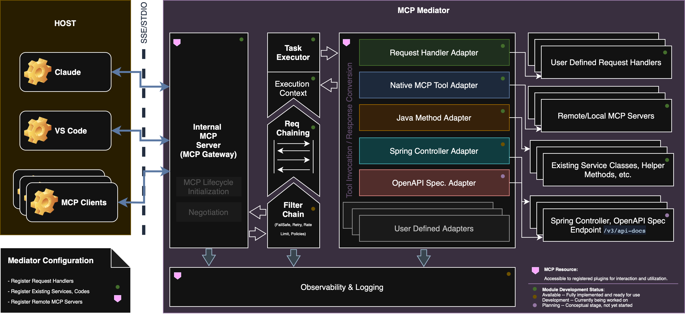
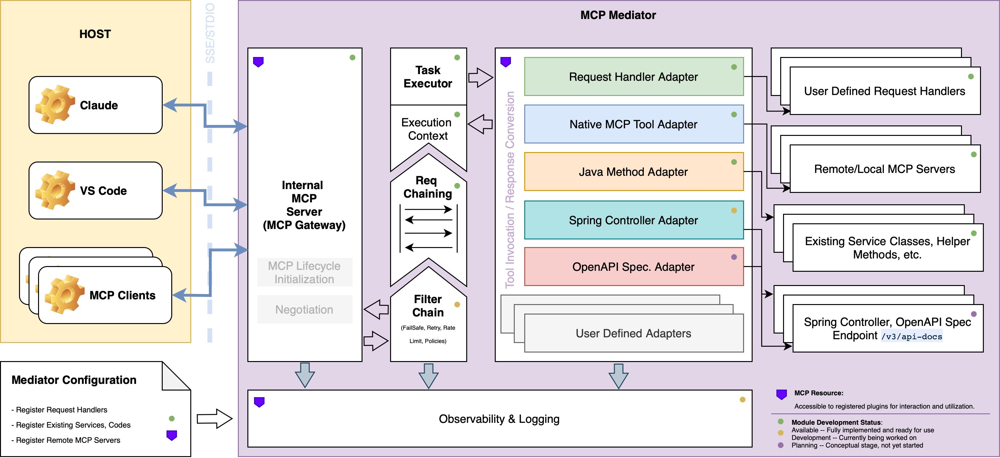

# MCP Mediator – Automatic MCP Server Generation

A Java-based implementation of a Model Context Protocol (MCP) mediator that automatically generates an MCP Server from existing source code, service classes, helper methods, and external MCP tools. The MCP Mediator aggregates these diverse components into a unified MCP Server, streamlining communication between MCP clients and servers through a single point.

By eliminating the need to manually maintain multiple MCP Servers, this tool simplifies integration and execution within the MCP ecosystem and make it possible to generate MCP Servers without altering the existing code bases and tools that are planned to be MCP compatible.




## Overview

The MCP Mediator implements the Model Context Protocol specification, providing a robust framework for:
- Handling MCP requests and responses
- Managing tool execution
- Supporting various transport mechanisms
- Integrating with Spring Framework and Spring Boot

For more information, visit the project's wiki: [MCP Mediator Wiki](https://github.com/makbn/mcp_mediator/wiki).
Wiki page is organized as follows:
- [Getting Started](https://github.com/makbn/mcp_mediator/wiki/1‐Getting-Started)  
- [Basic Usage](https://github.com/makbn/mcp_mediator/wiki/2‐Basic-Usage)  
- [Configuration](https://github.com/makbn/mcp_mediator/wiki/3‐Configuration)  
- [Components](https://github.com/makbn/mcp_mediator/wiki/4‐Components)  


## Features

- Support for stdio/sse transport
- Extensible request handling system
- Configurable server capabilities
- Support for multiple tool implementations
- Support for proxying multiple MCP servers
- Automatically generating MCP Server Tools for the existing methods and services
- Spring Framework and Spring Boot integration
- Comprehensive error handlin
- Docker Implementation
- Dropbox Implementation
- Generate MCP Server for existing Spring `Controllers` and mediate request between MCP client and controllers
- Generate MCP Server for existing OpenAPI specification and generate MCP `Tool` for the APIs and delegate the requests

## Modules

- `mcp-mediator-api`: Core API interfaces and contracts
- `mcp-mediator-core`: Core implementation and common functionality
- `mcp-mediator-commons`: Reusable components to make implementation easier
- `mcp-mediator-security`: Generic security context and thread propagation for non-Spring projects
- `mcp-mediator-spring`: Spring Framework and Spring AI integration
- `mcp-mediator-spring-security`: Bridges the mediator seamlessly into Spring Security's native `SecurityContextHolder`
- `mcp-mediator-spring-boot-starter`: Spring Boot `autoconfiguration` to generate MCP server automatically for the available endpoints
- `mcp-mediator-openapi`: Translates OpenAPI specifications directly into MCP tool endpoints
- `mcp-mediator-inspector`: Utilities for inspecting and debugging Mediator state
- `mcp-mediator-example`: Example shows how to use and extend the mediator framework
- Implementation modules for various services:
  - `mcp-mediator-implementation-docker`: Docker service integration [Read More](mcp-mediator-implementation-docker/README.md)
  - `mcp-mediator-implementation-dropbox`: Dropbox service integration (WIP)
  - `mcp-mediator-implementation-query`: Query services with public APIs: [List of all Query MCP Servers](#implemented-query-mcp-servers)

## Getting Started

### Prerequisites

- Java 21 or later
- Maven 3.6 or later
- Java 21 and Spring Boot 4.0 / 4.1 / 4.2 (Spring Framework 7) for the Spring integration (CI matrix: 4.0.9, 4.1.2, 4.2.0-RC2)

All the examples are available under `mcp-mediator-exmple` module. It's still a work in progress and the examples will be added.

## Default MCP Mediator 
To create a MCP Mediator with STDIO transport:

```java
DefaultMcpMediator mediator = new DefaultMcpMediator(McpMediatorConfigurationBuilder.builder()
          .createDefault()
          .serverName(MY_EXAMPLE_MCP_SERVER_STDIO)
          .build());
mediator.registerHandler(new WikipediaQueryRequestHandler());
mediator.initialize();
```

To run the examples as Claude Desktop MCP Server:
```yaml
{
  "mcpServers": {
    "my_java_mcp_server": {
      "command": "[path to]/run.sh",
      "args": [
        "DefaultMcpMediatorStdioExample"
      ]
    }
  }
}
```
This config runs `DefaultMcpMediatorStdioExample` sa STDIO MCP server. 
Make sure to make `run.sh` executable and add `mvn` command to your path.
```bash
 ./run.sh ClassName [arg1 arg2 ...]
```

This mediator runs a STDIO MCP server with handlers and delegates requests from MCP client  (e.g. Claude Desktop) to
the registered handlers. 

## Annotations: own vs. Spring AI

Think `@Resource` (standard) vs. `@Autowired` (richer): **both families work on the same classes and produce the
same MCP surface** (verified by the parity tests in `mcp-mediator-core`).

| Feature | Mediator's own (`io.github.makbn.mcp.mediator.api`) | Spring AI 2.x (`org.springframework.ai.mcp.annotation`) and 1.x (`org.springaicommunity.mcp.annotation`) |
|---|---|---|
| Tool / parameter | `@McpTool`, `@McpToolParam` | `@McpTool`, `@McpToolParam` |
| Resource / template | `@McpResource` (`{var}` in uri = template) | `@McpResource` |
| Prompt / argument | `@McpPrompt`, `@McpArg` | `@McpPrompt`, `@McpArg` |
| Completion | `@McpComplete` | `@McpComplete` |

* Both Spring AI generations are recognised: 2.x (`org.springframework.ai.mcp.annotation`, used with Spring Boot 4)
  and the community package of Spring AI 1.x (`org.springaicommunity.mcp.annotation`).
* Verified against Spring AI itself: `SpringAi2ReferenceParityTest` feeds one bean to Spring AI 2.1's own
  `Sync*Provider` classes and to the mediator and compares tool/resource/prompt/completion definitions (names,
  descriptions, schema properties, required, types, enums, item types) and call results.
* Coexistence: `examples/spring-ai-coexistence` runs Spring AI's MCP server starter and this starter together
  (the mediator is opt-in, so Spring AI keeps serving its `@McpTool` beans). Don't enable both on the same endpoint.
* Plain Java: use the own annotations (no Spring on the classpath), `mediator.registerBean(obj)` before `initialize()`.
  `@McpService` on the class is optional. See `AnnotatedBeanStdioExample`.
* Spring Boot: add the starter, set `mcp.mediator.enabled=true`; every singleton bean with annotated methods (either
  family, proxied or not, package-private is fine) is registered. Define your own `McpMediator` bean to take over
  (the auto-configuration backs off and registers the beans on yours).

Tool methods can declare a `McpSyncServerExchange`, `CallToolRequest` or Spring AI `McpSyncRequestContext` parameter and a
`@McpProgressToken String`; they are injected and hidden from the schema. Tool `title` and `annotations` hints are
advertised, `generateOutputSchema = true` publishes an output schema plus `structuredContent`, and `Mono`/`Flux` methods
are resolved. Resources, prompts and completions also accept the exchange/request types.

**Client side (proxy):** objects with Spring AI's `@McpSampling`, `@McpElicitation`, `@McpLogging`, `@McpProgress`,
`@McpToolListChanged`, `@McpResourceListChanged`, `@McpPromptListChanged` - or the mediator's
`@McpClientHandler(Kind.X)` - passed via `McpMediatorRemoteMcpServerConfiguration.builder().clientHandler(obj)` are
wired into the MCP client (single-parameter handler methods).

**Transports:** `mcp.mediator.transport=STDIO|SSE|STREAMABLE_HTTP|STATELESS_HTTP|MODERN_HTTP`; streamable HTTP is mounted at `/mcp` in servlet apps
(`StreamableHttpSampleAppTest` is the sample app).

`McpMeta` (own or Spring AI's) is injected into tool methods; multi-argument logging/progress handler signatures
(`level, logger, data` / `@McpProgressToken token, progress, total, message`) are bound. SSE (`/sse`,
`/mcp/message`) and streamable HTTP (`/mcp`) are auto-mounted. `LiveClientRoundTripTest` runs a real SDK client against
the Spring Boot server, including server-initiated sampling answered by annotated client handlers.

`McpAsyncRequestContext` and `McpAsyncServerExchange` are injectable too. Client handlers honour `clients = "name"`
routing: set `McpMediatorRemoteMcpServerConfiguration.builder().name("name")` on the connection (no name = all handlers).
`mcp.mediator.transport=STATELESS_HTTP` serves `/mcp` without sessions (tools then receive a `null` exchange).

`icons` (`@McpIcon`), `requiredCapabilities`, `size` and `metaProvider` are honoured (own or Spring AI annotations).
`MODERN_HTTP` serves the same beans through the MCP SDK's "modern" server API (the one Spring AI 2.1's `Modern`
providers use) at `/mcp`; `McpRequestContext` and Spring AI's `McpModernSyncRequestContext` are injectable there
(`ModernHttpTest` runs the SDK's modern client against it and diffs definitions with Spring AI's own Modern providers).
For Spring AI-annotated tools, parameters without `@McpToolParam` are required (Spring AI semantics); for the
mediator's own annotations they stay optional unless `@NotNull`/`required=true`, as before.

Coverage guard: `SpringAiAnnotationCoverageTest` reflects over every Spring AI 2.x MCP annotation and fails when an
attribute is neither handled nor explicitly listed, so a new upstream attribute cannot be silently ignored.
`@McpToolParam(header = true)` (schema keyword `x-mcp-header`) and `@McpArg(title)` are supported.

Version note: Spring AI 2.1.0-RC2 was compiled against MCP SDK 2.2.0-M2; against the 2.2.0 GA SDK (used here) its
`McpModernSyncRequestContext.inputResponse(key, Class)` throws `NoSuchMethodError` (upstream skew) - use
`inputResponses()`, or wait for a Spring AI release built on the GA SDK.

Known limits: with the stateless transport there is no server exchange, so exchange/context parameters are `null`;
the modern server's sampling/roots rounds use the SDK's input-required mechanism (see below).
Spring AI's own server starters should not be enabled on the same endpoint.
Resource `annotations` (audience/priority/lastModified), `ttlMs` and `cacheScope` (modern server) are applied; the modern
server supports input-required rounds (elicitation) by returning `InputRequiredResult` from a method. Spring AI's classic
provider ignores resource `annotations`, the mediator maps them per the MCP spec.

## Convert Existing Code to MCP Server
Convert the existing code, service, helper class, or method automatically to an MCP server using `@McpService`: 
```java
DefaultMcpMediator mediator = new DefaultMcpMediator(McpMediatorConfigurationBuilder.builder()
                .createDefault()
                .serverName(MY_EXAMPLE_MCP_SERVER_STDIO)
                .serverVersion("1.0.0.0")
                .build());
// DockerClientService is an existing service class to interact with the installed Docker Client
        mediator.registerHandler(McpServiceFactory.create(new DockerClientService(dockerClient))
                .createForNonAnnotatedMethods(false)
                .build());
        mediator.initialize();
```

DockerClientService:

```java
@McpService(name = "docker_mcp_server",  description = "provides common docker command as mcp tools")
public class DockerClientService {

    DockerClient internalClient;

    @McpTool(name = "docker_start_container",
            description = "start an existing docker container using its containerId! containerId is required and " +
                    "can't be null or empty! if successful, returns true.")
    public boolean startContainerCmd(@NonNull String containerId) {
        internalClient.startContainerCmd(containerId)
                .exec();
        return true;
    }
    // ...
}
```

Checkout `mcp-mediator-implementation-docker` for more details.

##  Proxy MCP Mediator
To create a proxy server:
```java
 // as an example ~/sdk/jdk/jdk-17.0.14+7/Contents/Home/bin/java
String command = args[0];
// e.g., -jar ~/mcp-mediator-example.jar
List<String> remoteServerArgs = List.of(Arrays.copyOfRange(args, 1, args.length));

ProxyMcpMediator mediator = new ProxyMcpMediator(McpMediatorConfigurationBuilder.builder()
       .creatProxy()
       .serializer(new ObjectMapper())
       .tools(true)
       .addRemoteServer(McpMediatorProxyConfiguration.McpMediatorRemoteMcpServerConfiguration.builder()
               .remoteTransportType(McpTransportType.STDIO)
               .remoteServerAddress(command)
               .remoteServerArgs(remoteServerArgs)
               .build())
       .serverName(MY_EXAMPLE_MCP_SERVER_STDIO)
       .serverVersion("1.0.0.0")
       .build());

mediator.initialize();
```
This mediator creates a Proxy MCP server and connects to all the given remote servers and works as a proxy between the 
client and the remote servers. The mediator will advertise all the available `Tools` to the clients during the 
initialization process. It is also expandable by registering request handlers using `ProxyMcpMediator#registerHandler()`
same as `DefaultMcpMediator`.


### Implemented Query MCP Servers

Query MCP servers are MCP servers that receive a query from the user and search a source for the content related to the input 
query. All the queries are part of `mcp-mediator-implementation-query` module and are defined using MCP Mediator Request Handlers.
So far, these queries are implemented:
- Wikipedia MCP Server: Search Wikipedia with an input query
- Stackoverflow MCP Server: Search Stackoverflow website
- GitHub MCP Server: Search for GitHub projects


## Contributing

Contributions are welcome! Please feel free to submit a Pull Request. [Read this first](CONTRIBUTING.md)!

## License

This project is licensed under the GPL3 License - see the [LICENSE](https://choosealicense.com/licenses/gpl-3.0/) file for details.

## Security & Authorization

MCP Mediator supports native integration with authorization frameworks, including **Spring Security**. 
Since MCP requests (especially over `STDIO`) rely purely on JSON payloads, you can use the `McpMediatorInterceptor` to extract tokens from the arguments payload and bridge them into your security context.

We provide two dedicated modules for this:
- **`mcp-mediator-security`**: Generic security context and thread propagation for non-Spring projects.
- **`mcp-mediator-spring-security`**: Bridges the mediator seamlessly into Spring Security's native `SecurityContextHolder`.

For complete implementation details and code examples, please check out the [Security Integration Guide](https://github.com/makbn/mcp_mediator/wiki/3%E2%80%90Configuration#security--authorization-interceptors) in the Wiki, or refer to `GenericSecurityExample` and `SpringSecurityExample` in the `mcp-mediator-example` module.

## Observability & Error Handling Examples

The `mcp-mediator-example` module includes dedicated examples demonstrating how to fully instrument the Mediator:
- **`ObservabilityExample`**: Shows how to programmatically inject an `OpenTelemetry` instance to export traces (via OTLP for Datadog or `LoggingSpanExporter` for standard SLF4J logs).
- **`CustomErrorHandlerExample`**: Demonstrates customizing the `McpMediatorExceptionHandler` to intercept execution errors, route them through an SLF4J logger, and return safe, obfuscated fallback strings to the client without exposing internal Java stack traces.
